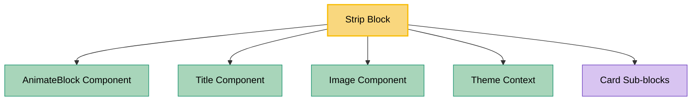

# Strip Block Dependencies

## Dependency Graph

## Component Details

### Strip Block

- **File**: `src/blocks/Strip/Strip.tsx`
- **Description**: Displays card sub-blocks or a themed responsive image strip in wrapping or
  marquee layouts.

### Dependencies

- **AnimateBlock**: Handles the optional entrance animation.
- **Title**: Renders the optional title and YFM description.
- **Image**: Renders the desktop/tablet/mobile image sources without a card wrapper.
- **Theme Context**: Selects the light or dark image source set.
- **Card Sub-blocks**: Render through PageConstructor's standard `children` pipeline, matching the
  Slider card contract.
