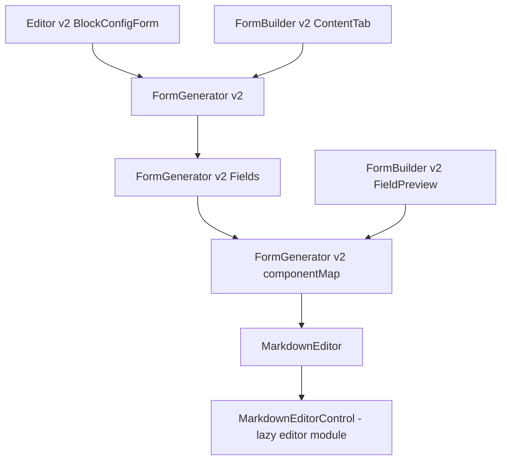

# MarkdownEditor Component Usage

This document describes the internal Markdown field used by FormGenerator v2, FormBuilder v2, and Editor v2.

## Overview

`MarkdownEditor` renders a `type: 'markdownEditor'` field using `@gravity-ui/markdown-editor`. A single control supports visual (`wysiwyg`) and Markdown source (`markup`) editing; it starts in visual mode. Field content remains a Markdown/YFM string at the configured path in the content object.

The field is registered in the FormGenerator v2 component map. FormBuilder v2 uses the same registration for its canvas and generated preview form. Editor v2 receives it through the selected block's input configuration.

## Usage Graph



## Component Details

### Implementation and Consumers

| File                                                                    | Responsibility                                                                                               |
| ----------------------------------------------------------------------- | ------------------------------------------------------------------------------------------------------------ |
| `src/form-generator-v2/components/MarkdownEditor/MarkdownEditor.tsx`    | Resolves the field value, integrates shared field wrappers, and loads the editor on demand.                  |
| `src/form-generator-v2/components/constants.ts`                         | Maps `markdownEditor` to the field component.                                                                |
| `src/form-generator-v2/components/Fields/Fields.tsx`                    | Renders configured fields through the component map.                                                         |
| `src/form-generator-v2/FormGenerator.tsx`                               | Writes field updates into the content object by path and reports them through the existing update callbacks. |
| `src/form-builder-v2/components/CanvasCard/components/FieldPreview.tsx` | Renders the same field component on the builder canvas with its own content state.                           |
| `src/form-builder-v2/components/ContentTab/ContentTab.tsx`              | Renders a FormGenerator preview and the resulting content JSON.                                              |
| `src/editor-v2/containers/BlockConfigForm/BlockConfigForm.tsx`          | Renders the selected block's inputs and forwards changes into the editor store.                              |

### Field Configuration

`MarkdownEditorField` is declared in `src/form-generator-v2/types.ts`:

| Property       | Type               | Required | Meaning                                                    |
| -------------- | ------------------ | -------- | ---------------------------------------------------------- |
| `type`         | `'markdownEditor'` | yes      | Selects the rich text field.                               |
| `name`         | `string`           | yes      | Content path, including nested or repeating-section paths. |
| `title`        | `string`           | yes      | Field label.                                               |
| `defaultValue` | `string`           | no       | Initial content when the path is undefined.                |
| `placeholder`  | `string`           | no       | Hint shown by an empty control.                            |
| `when`         | `When`             | no       | Shared conditional visibility rules.                       |

The runtime component also receives `content` and `onUpdate` through `CommonProps`. An update calls `onUpdate(name, markdownString)`, preserving the normal FormGenerator content shape. There is no public mode setting in the field schema.

## Usage Patterns

### Independent Fields and Nested Paths

```tsx
const fields: Fields = [
  {
    type: 'markdownEditor',
    name: 'description',
    title: 'Description',
    placeholder: 'Describe the page',
  },
  {
    type: 'markdownEditor',
    name: 'details.body',
    title: 'Details',
    defaultValue: '## Details\n\nRead the [documentation](/docs).',
  },
];
```

Each field owns its editor instance and content path. Repeating sections resolve paths such as `items[{{index}}].body` before rendering the field. The builder canvas uses its existing template content state for template paths and its normal canvas content state for concrete paths.

### Builder Configuration and JSON Roundtrips

FormBuilder v2 exposes the field in its palette, default-field factory, and shared text settings. Its default-value setting is multiline and preserves an explicit empty string. The placeholder and existing title, name, and visibility settings are editable in the inspector.

`src/form-builder-v2/utils/parseSchema.ts` accepts the new discriminator, requires string `name` and `title`, and checks optional `defaultValue` and `placeholder` values are strings. `stripIds.ts` exports the configuration without builder ids. Import/export must preserve Markdown/YFM defaults, whitespace, nested fields, and explicit empty strings.

Canvas keyboard handling in `CanvasCard.tsx` applies Enter/Space selection only when the card itself is the event target. Input events from the embedded editor must remain available to the editor.

### JSON Schema Opt-in

`src/form-generator-v2/utils/generateFormFieldsFromAjv.ts` generates this field for string schemas with `inputType: 'markdownEditor'`. String `default` and `placeholder` values are copied into field settings. String enums retain their existing selection control, and existing `contentType: 'yfm'` or `inputType: 'textarea'` configurations continue to generate `textArea`.

## String Contract and State Synchronization

- Existing content takes precedence over `defaultValue`. An explicit `''` remains empty.
- Loading an existing value must not publish a newly serialized document. Source text is retained until the user edits it.
- Visual editing can normalize Markdown syntax and whitespace. Source mode is available for exact source changes and YFM syntax without a visual representation.
- Parent echoes of a local change must not recreate the editor or reset the caret. External reset and undo values must replace the displayed document without producing a feedback update.
- Instances must remain independent when several fields are rendered together. A changed field path or selected block must not reuse another field's document or history. `BlockConfigForm` keys its FormGenerator by the selected block path, and the field wrapper keys its editor by `name`.
- Visibility and default initialization reuse `Base`: hiding a previously visible field clears its content path, and showing an undefined field can initialize its default.

## Loading and Styling

`React.lazy` loads the rich editor module when the field is rendered. `Suspense` displays a plain `TextArea` while loading; an error boundary retains the text control if loading or rendering fails. Both controls use the same string value and update callback. The field has no separate SSR guard.

Keep the `.js` extension in the dynamic import of `MarkdownEditorControl`: the CJS build uses `NodeNext` resolution, which requires explicit extensions for `import()`. Both Storybook and widget Webpack configs use `resolve.extensionAlias` to map that emitted path to the source `.tsx` file. Verify `npm run build` as well as typecheck; the latter uses bundler resolution and does not check declaration emission.

`MarkdownEditor.scss` uses the form-generator BEM helper and Gravity theme variables. Verify both light and dark themes and narrow builder layouts when changing the editor toolbar or popups.

## Storybook and Verification

- `src/form-generator-v2/__stories__/MarkdownEditor.stories.tsx` provides the **Default** story under **FormGenerator/MarkdownEditor**, demonstrating two independent fields with default content and a placeholder.
- `src/form-builder-v2/__stories__/FormBuilderV2.stories.tsx` includes **MarkdownEditors** under **FormBuilder/v2**, demonstrating the same two independent fields with default content and a placeholder.

When changing the editor integration, verify actual browser editing as well as schema utilities: Enter/Space input, mode switching, independent values, external updates, conditional visibility, and repeating-section changes.
