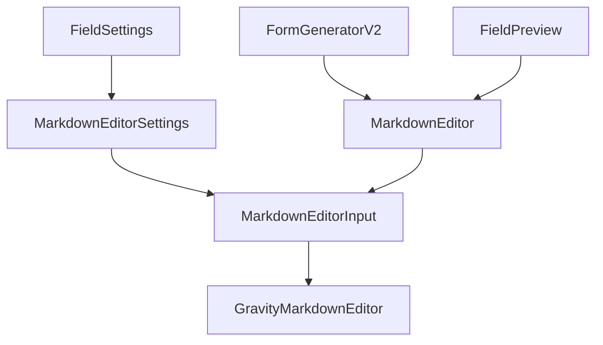

# MarkdownEditorInput

## Overview

Controlled Markdown/YFM input shared by FormGenerator v2 and FormBuilder v2.
Implementation: `src/components/MarkdownEditorInput/MarkdownEditorInput.tsx`.
Import it directly; it has no barrel export or page-block registration.

## Usage Graph

## Component Details

- Accepts `value: string`, `onUpdate`, optional `placeholder`, `className` and `qa`.
- Imports the editor implementation statically with the project's usual
  extensionless import. Its engines and runtime dependencies load with the component.
- Renders a controlled UIKit `TextArea` during SSR and the first client render,
  preserving the value, placeholder, class name and QA attribute. Mounts the
  browser-only editor after `useEffect` so hydration starts with matching markup.
- Creates an editor with the YFM preset, visual mode initially and a source-mode
  switch in the settings menu. Raw HTML parsing from Markdown is disabled;
  no local file upload handlers are configured. HTML clipboard input is still accepted.
- Uses `safeYfmFile` to check attachment URLs before rendering them into the DOM.
  HTTP(S) and relative links retain the standard file rendering; unsafe schemes and
  malformed URLs render the file name as text. The Markdown value is preserved.
- Subscribes to `change`, serializes with `getValue()` and applies external
  changes with `replace()`. A ref prevents external replacements from being
  echoed and avoids replacing the document when the parent acknowledges an edit.
- Preserves the editor during typing and callback changes. Changing the placeholder
  recreates it. Consumers key by field identity to isolate documents and undo state.
- `BlockConfigForm` keys `FormGenerator` by the selected block's full tree path,
  including parent paths for sub-blocks. Selecting a different path unmounts the previous
  editor and resets its Undo/Redo history; updates within the same block keep it.
  A field name alone cannot identify a document across blocks. Standalone consumers
  that switch documents must also key their form by document identity.
- Provides the required UIKit toaster context internally. Uses UIKit theme tokens
  and reads the editor language from `LocaleContext.lang`, falling back to
  `Lang.Ru` when the locale has no language. Calls the editor's global `configure()`
  in `useEffect` without requesting another render. Locale changes retain the
  editor instance and undo history; label updates have the limitation below.
- Keeps toolbar and content inside narrow containers, with bounded content height.
- Uses the text cursor over the editing area in both modes, including inside
  clickable builder cards. Toolbar controls retain their own cursors.

The public `MarkdownEditorField` descriptor has `type: 'markdownEditor'`, `name`,
`title`, optional `defaultValue`, `placeholder` and `when`. The renderer delegates
defaults, visibility, nested paths and repeating sections to existing form helpers.
An explicit empty content value is preserved over its default.

## Dependencies and Compatibility

`@gravity-ui/markdown-editor` is pinned to `15.47.0` with its CJS-compatible
`uuid` dependency at `11.0.5` to preserve the existing CJS build.
Required peers are declared explicitly; optional editor extensions are not enabled.
Existing text fields and AJV conversion are unchanged.

## Storybook

- `Components/MarkdownEditorInput`: default, empty, dark and narrow variants.
- `FormGenerator/MarkdownEditor`: default and repeating section.
- `FormBuilder/v2/Markdown`: palette, inspector default editor and canvas editing.
- The global `withLang` decorator configures UIKit and remounts the story on
  language changes. It does not pass the selected language to `LocaleContext`.

## Known Limitations

- Changing `LocaleContext.lang` does not immediately update the editor's button
  labels: `configure()` runs after rendering and does not trigger another render.
  Labels can retain the previous language until a later render.
- The Storybook language selector does not update the editor's locale because
  `withLang` configures only UIKit. Without an explicit `LocaleContext` provider,
  the editor uses the context's Russian default.
- `safeYfmFile` validates only attachment nodes, not ordinary link marks.
  `md.html: false` does not sanitize HTML clipboard input. Pasting an ordinary
  `<a href="javascript:…">` can create an executable link; clicking it ran a
  marker in a local JSDOM reproduction. General pasted-link safety is unresolved.

## Validation

Unit tests cover change notifications, external updates, listener cleanup, defaults,
empty values, conditional visibility, repeating rows, inspector updates and schema
round trips. SSR tests render real Markdown fields without a DOM; a hydration test
checks the fallback-to-editor transition with the real editor and no recoverable
hydration errors. Security tests use the real editor to check unsafe attachment URLs,
obfuscated protocols, relative links and external content replacements.

`MarkdownEditorInput.locale.test.tsx` defines two regressions for immediate locale
updates and the Storybook language selector. Both currently fail due to the
limitations above; their presence does not confirm that locale updates work.

Browser component tests are defined for visual/source editing, unsafe attachment
URLs in source mode and HTML paste, narrow light/dark layouts and builder integration.
The review run could not launch the required Chromium executable, so browser
behavior was not verified. These attachment tests do not cover ordinary pasted links.
