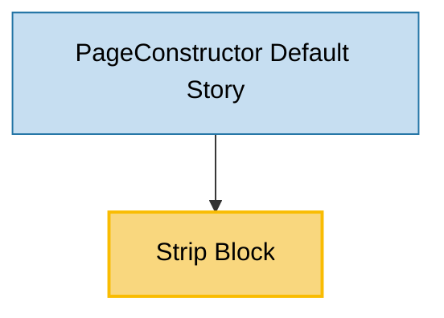

# Strip Block Usage

## Overview

Strip displays either card sub-blocks using the same `children` contract as `Slider` or a themed
responsive image strip using the same `images` contract as `Companies`. It supports an adaptive
wrapping layout and a continuously moving marquee layout.

## Usage Graph

## Component Details

### Strip Block

- **File**: `src/blocks/Strip/Strip.tsx`
- **Storybook**: `Blocks/Strip`
- **Block type**: `strip-block`
- **Description**: Renders child cards or a responsive image strip in a wrapping list or an
  accessible marquee.
- **Dependencies**: `AnimateBlock`, `Title`, `Image`, theme context, and PageConstructor child-card
  rendering.
- **Key props**:
  - `children`: Array of cards from the shared card schema.
  - `images`: Either the exact `CompaniesBlockProps['images']` object or an array of responsive
    image items. Each array item uses desktop, tablet, and mobile sources and can include a link.
  - `color`: Optional `text-color` mode that recolors every image in the block.
  - `layout`: `wrap` by default or `marquee` for continuous movement.
  - `colSizes`: Optional responsive card width using the same 12-column contract as `CardLayout`.
  - `itemHeight`: Shared height for every item in pixels or `auto`; defaults to `48px`.
  - `gap`: Horizontal and vertical spacing in pixels.
  - `duration`: Marquee cycle duration in seconds.
  - `pauseOnHover`: Pauses marquee movement on pointer hover.
  - `title` and `description`: Optional block heading.
  - `animated`: Enables the entrance animation.

Exactly one of `children` and `images` is required. Image mode renders the common `Image` component
directly without an `ImageCard` wrapper. `getImageItems` normalizes a Companies image object into
a single list item; the schema reuses the Companies image schema. The `One Image` story demonstrates
the Companies format, and the other image stories retain the array format.
The `Cards` story renders BasicCard, BackgroundCard, LayoutItem, PriceCard, and ImageCard strips
together from `args.blocks`, with Controls restricted to `blocks` so the controls and YAML reflect
the same page configuration. All five card types reuse the CardLayout story data without numbering;
PriceCard includes outlined, action, and monochrome button variants. Each strip contains six items
so it overflows and demonstrates the marquee.
LayoutItem copies must have separate nested `content` objects: the YFM parsers mutate those fields,
and transforming several items sharing one object repeatedly escapes the generated HTML.
Image stories render Strip directly with 48px padding, following CardLayout/Slider conventions.
The `Cards` story must retain PageConstructor: its grid styles give BackgroundCard content columns
relative positioning, keeping the content above the absolutely positioned background image.
Removing PageConstructor without providing those styles hides card content behind the background.
PageConstructor page stories use `images` for both moving and static image strips.
A block with `color: 'text-color'` keeps the intrinsic
dimensions and accessible image metadata but visually renders all its images as responsive
monochrome masks filled with `var(--g-color-text-primary)`.
The inner picture must inherit the colorized wrapper's full height so toggling color preserves
the configured image height and aspect ratio.

The marquee measures the original item list and starts only when it overflows the viewport. A short
list stays static and centered. An active marquee duplicates its visual list with `aria-hidden` and
removes the duplicate controls from sequential keyboard navigation while keeping them clickable
with a pointer. It then accounts for the gap between copies in its animation offset, so every loop
is seamless without duplicating keyboard focus targets. Its viewport has vertical breathing
room so card hover transforms and shadows are not clipped. Active marquees have 64px edge overlays
filled with `background-color: var(--g-color-base-background)` and faded using alpha gradient masks.
Keeping the color separate from the mask avoids gray interpolation artifacts in Linux WebKit.
They use `pointer-events: none` so links remain clickable and are absent for static strips and reduced motion.
It becomes a static wrapping list when
the operating system requests reduced motion. At 768px and below, the moving viewport spans the
full screen width; on desktop, it remains in the content grid. The heading always remains in the
content grid.

The optional title and description are centered and occupy 10 grid columns on desktop and all 12
columns on mobile.

## Visual Tests

`src/blocks/Strip/__tests__/Strip.visual.test.tsx` uses composed Storybook stories and the shared
Playwright screenshot fixture. Coverage is limited to the Default story at 1280px and the `md`
breakpoint (`BREAKPOINTS.md`, 769px), in light and dark themes for Chromium and WebKit: eight
baseline images in total. The shared screenshot fixture disables animations when capturing images.
